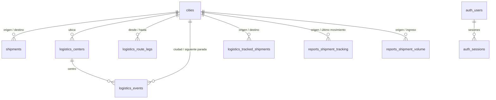

# TrackFlow · Base de datos

Base única en Supabase (PostgreSQL 17) que comparten las tres Web APIs de TrackFlow.
Cada API trabaja solo con sus tablas; ninguna lee tablas de otra salvo las lecturas de
referencia indicadas abajo.

- Proyecto Supabase: `ksknhtmvhvlkutbfyfte` (org *Fabrica Escuela*, us-east-2)
- Esquema completo: [`schema.sql`](schema.sql) (generado desde las migraciones V1–V22)

## Dueños de las tablas

| API | Escribe | Solo lee |
|---|---|---|
| 1 · Envíos y acceso | `shipments`, `cities`, `auth_users`, `auth_sessions`, `flyway_schema_history` | `logistics_centers` (cobertura) |
| 2 · Reportes | `reports_shipment_tracking`, `reports_shipment_transit`, `reports_shipment_volume` | `cities`, `auth_sessions` |
| 3 · Logística | `logistics_events`, `logistics_tracked_shipments`, `logistics_centers`, `logistics_route_legs` | `cities`, `auth_sessions` |

## Relaciones



Las únicas llaves foráneas que cruzan de una API a otra apuntan a `cities`.
Entre envíos, logística y reportes no hay llaves: se relacionan por `tracking_number`
y los datos viajan por eventos (RabbitMQ).

## Tablas

| Tabla | Llave | Qué guarda |
|---|---|---|
| `cities` | `id` | Catálogo de ciudades (único por nombre + departamento) |
| `shipments` | `id`, único `tracking_number` | Envío registrado: remitente, destinatario, estado |
| `auth_users` | `username` | Usuarios con hash BCrypt y roles (`operador`, `administrador`) |
| `auth_sessions` | `jti` | Una sesión por token emitido; `closed_at` no nulo = sesión cerrada |
| `logistics_centers` | `id` | Centros de distribución por ciudad |
| `logistics_route_legs` | `id`, único (`from_city_id`, `to_city_id`) | Tramos de la red de rutas con duración en horas |
| `logistics_events` | `id`, único `event_id` | Movimientos del envío (recibido, despachado, en reparto, entregado) |
| `logistics_tracked_shipments` | `tracking_number` | Envíos que logística conoce, con origen y destino |
| `reports_shipment_tracking` | `tracking_number` | Proyección para el rastreo (HU-03) |
| `reports_shipment_transit` | `tracking_number` | Proyección de tiempos de tránsito (HU-05) |
| `reports_shipment_volume` | `tracking_number` | Proyección de volumen de envíos (HU-07) |

Extensión requerida: `unaccent` (búsqueda de ciudades y centros sin tildes, V9).

## Migraciones

Las ejecuta **solo la API 1** con Flyway (`src/main/resources/db/migration`).
Las APIs 2 y 3 arrancan con `spring.flyway.enabled=false` y
`spring.jpa.hibernate.ddl-auto=validate`, así que la API 1 se despliega primero.
Un cambio de esquema en cualquier tabla se hace como nueva migración (V23+) en el
repositorio de la API 1.

| Versión | Cambio |
|---|---|
| V1 | Esquema inicial |
| V2 | Tipo de documento separado |
| V3 | Fecha real del movimiento |
| V4 | Catálogo de ciudades |
| V5 | Origen y nombres en tracking |
| V6 | Catálogo de centros |
| V7 | Origen y destino en envíos rastreados |
| V8 | Centro en eventos logísticos |
| V9 | Búsqueda sin tildes (`unaccent`) |
| V10 | Repartidor en salida a reparto |
| V11 | Dirección de destino en tracking |
| V12 | Usuarios y sesiones |
| V13 | Proyección de volumen |
| V14 | Proyección de tiempos de tránsito |
| V15 | Cobertura de ciudades |
| V16 | Red de rutas |
| V17 | Ciudad en eventos logísticos |
| V18 | Transbordo en hub queda en tránsito (datos) |
| V19 | Siguiente parada del despacho |
| V20 | Siguiente parada con empates (datos) |
| V21 | Duración del tramo en despachos |
| V22 | Registro anterior al primer movimiento (datos) |

## Conexión

Variables de entorno de cada servicio en Render (nunca en el repositorio):

```
TRACKFLOW_DB_URL=jdbc:postgresql://<host-del-pooler>:5432/postgres
TRACKFLOW_DB_USER=<usuario>
TRACKFLOW_DB_PASSWORD=<clave>
```

- Usar el pooler de Supabase en modo *session* (puerto 5432); Flyway no funciona bien en modo *transaction*.
- Pool máximo por API: `spring.datasource.hikari.maximum-pool-size=3`.
- El plan gratuito pausa el proyecto tras ~7 días sin actividad y no hace respaldos automáticos: hacer `pg_dump` antes de cambios grandes.

## Seguridad

- La Data API (REST) de Supabase debe quedar **desactivada**: las tablas no usan RLS.
- Revocar permisos a los roles públicos de Supabase:
  ```sql
  revoke all on all tables in schema public from anon, authenticated;
  ```

## Regenerar `schema.sql`

Con Docker, desde el repositorio del backend:

```sh
docker run -d --rm --name tf-db -e POSTGRES_PASSWORD=x -e POSTGRES_DB=trackflow postgres:17-alpine
for f in $(ls src/main/resources/db/migration/*.sql | sort -V); do
  docker exec -i tf-db psql -q -1 -U postgres -d trackflow < "$f"
done
docker exec tf-db pg_dump -U postgres -d trackflow --schema-only --no-owner --no-privileges > schema.sql
docker rm -f tf-db
```
